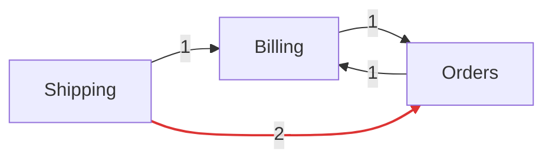

# Living documentation

Generate Markdown documentation of the real architecture, straight from the code:

```bash
php artisan cordon:docs                     # writes docs/architecture/
php artisan cordon:docs --output=docs/modules
php artisan cordon:docs --diagrams=c4       # also writes architecture.puml
```

The output folder (`docs/architecture` by default, relative to the project root) is created if it doesn't exist. Commit it: the diffs show how the architecture changes.

| File | Content |
|---|---|
| `README.md` | Every module with its namespace, dependencies, users and violation count, and a Mermaid diagram of the dependencies. Edge labels count the classes used; edges with internal access are red. |
| `modules/<Module>.md` | A canvas per module: its description and owner (from `metadata`), namespace, path, `depends_on`, a diagram of the module and its neighbours, its components grouped by Laravel role, its public API, the classes it uses from other modules and the ones other modules use from it (internal ones flagged), its events and its violations. |
| `events.md` | Every module event with the classes that publish and listen to it. |
| `architecture.puml` | Only with `--diagrams=c4` (`--diagrams=mermaid` is the default): the C4-PlantUML diagram of the modules, in the format of `cordon:graph --format=c4`, with the violations in red. Like the Markdown, it counts every violation in the code, while `cordon:graph` leaves out the ones in the baseline. See [the whole graph](./explore#the-whole-graph). |

GitHub and GitLab render the Mermaid diagrams. The output is deterministic (sorted, no timestamps), so you can commit it and see architecture changes in pull request diffs.



## Components and metadata

Each canvas groups the module's classes by role: Models, Controllers, Commands, Jobs, Listeners, Events, Policies, Notifications, Mail and Other. A known Laravel parent class decides first (a class that extends `Illuminate\Database\Eloquent\Model` is a model wherever it lives), then a namespace segment (`Listeners`, `Jobs`...), then `ShouldQueue` for jobs.

Describe a module and name its owner in `config/cordon.php`; the canvas shows them at the top:

```php
'modules' => [
    'Billing' => ['metadata' => ['description' => 'Invoices and payments.', 'owner' => 'payments-team']],
],
```

## Events

Events are detected statically:

- classes under a module's `Events` namespace;
- classes dispatched with `event(new X)`, `broadcast(new X)`, `$dispatcher->dispatch(new X)` or `Event::dispatch(new X)`;
- classes registered with `Event::listen(X::class, ...)`.

Publishers also include `X::dispatch()` and listeners include `handle(X $event)` / `__invoke(X $event)`, but only for classes that are already events, because jobs use the same method names.

String event names and wildcard listeners are not detected.

## Tables

With the [`tables`](./rules#tables) rule on, each canvas has a Tables section: the tables the module owns (the ones its migrations create), the tables of other modules it uses, and the tables without a single owner, with why. A table that two modules create is listed as `audit_log` (created by Billing and Catalog) in both, and in the card of a module that only uses it. A model whose `$table` is not a literal is listed with that reason. The section is not written while the rule is off, so a project that does not use it gets the same files as before. The documentation reads the modules only, so a table that a migration in `database/migrations` also creates shows its module as the owner here, while `cordon:verify`, which reads the code outside the modules too, sees two creators.

## Violations

The documentation shows every violation, ignoring the baseline: it describes the code as it is.
